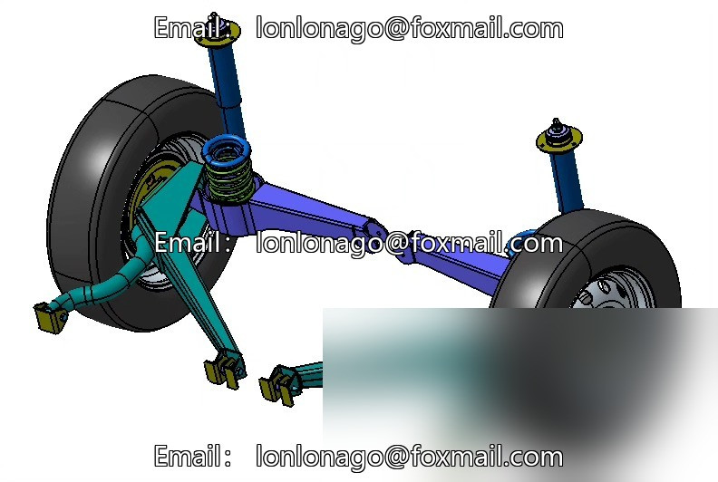
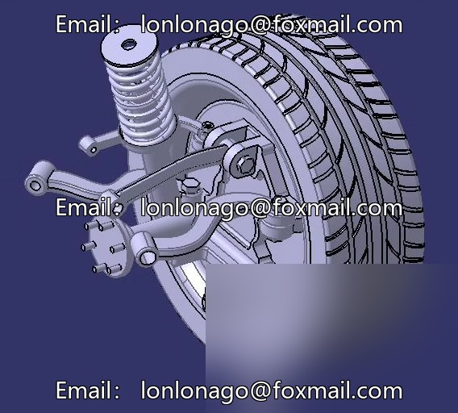

# Multi-link suspension model, multi-link suspension 3D, multi-link suspension data model, multi-link suspension data model

## Body

Multi-link suspension scan model, multi-link suspension 3D, multi-link suspension data model, multi-link suspension three-dimensional model.
Multiple models can be opened and edited with CATIA UG SolidWorks and other software.
A004 There are other various 3D drawings as well; services such as modeling and data model modification, etc., will be discussed specifically.

The image is empty; related content includes multi-link suspension number models, 3D models and 3D diagrams, along with modeling and number-model modification services.

<!-- AI_ENRICHED -->

## Images

## Payment

Here is a pay link on Stripe ( https://buy.stripe.com/3cs8yP7sY87d0vu9AB ). Please contact me lonlonago@foxmail.com after funding $89, and I will send you a complete data files , thank you!

